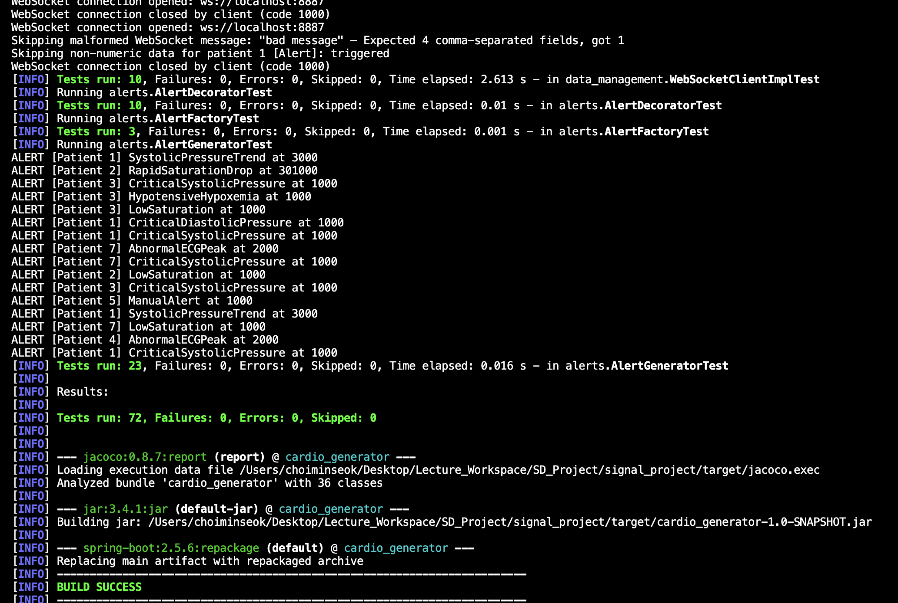

# Cardio Health Monitoring System (Java)

A Java system that simulates real-time cardiovascular data (ECG, blood pressure, blood saturation, blood levels) for many patients, stores it, and raises alerts when readings cross clinical thresholds. Data can be streamed to the console, files, TCP or WebSocket clients.

> Pair project for the **Software Development** course, BSc Data Science & AI, Maastricht University (2026), built on the course's [starter simulator](https://github.com/tpepels/signal_project) by Tom Pepels (MIT). Team: **Minseok Choi** and **Anastasios Vlachmpeis**.

## My contributions

- **Data layer:** `FileDataReader`, `Patient.getRecords` time-range queries, and the WebSocket client (`WebSocketClientImpl`) that feeds live data into `DataStorage`
- **Design patterns:** Singleton for `DataStorage` / `HealthDataSimulator`, the alert Decorator hierarchy (`PriorityAlertDecorator`, `RepeatedAlertDecorator`), and output decorators for timestamp validation and priority tagging
- **Testing:** JUnit 5 tests for data management, the WebSocket client and decorators; JaCoCo coverage setup and report ([notes](docs/coverage_report_notes.md))
- **UML:** Data Storage and Patient Identification subsystem diagrams with design rationale

Anastasios built the alert generator with the Factory and Strategy classes, the alert generation and data access layer UML, and the Javadoc for the simulator.



---

The Cardio Data Simulator is a Java-based application designed to simulate real-time cardiovascular data for multiple patients. This tool is particularly useful for educational purposes, enabling students to interact with real-time data streams of ECG, blood pressure, blood saturation, and other cardiovascular signals.

## Features

- Simulate real-time ECG, blood pressure, blood saturation, and blood levels data.
- Supports multiple output strategies:
  - Console output for direct observation.
  - File output for data persistence.
  - WebSocket and TCP output for networked data streaming.
- Configurable patient count and data generation rate.
- Randomized patient ID assignment for simulated data diversity.

## Getting Started

### Prerequisites

- Java JDK 11 or newer.
- Maven for managing dependencies and compiling the application.

### Installation

1. Clone the repository:

   ```sh
   git clone https://github.com/MinDaProgrammar/cardio-health-monitoring.git
   ```

2. Navigate to the project directory:

   ```sh
   cd cardio-health-monitoring
   ```

3. Compile and package the application using Maven:
   ```sh
   mvn clean package
   ```
   This step compiles the source code and packages the application into an executable JAR file located in the `target/` directory.

### Running the Simulator

After packaging, you can run the simulator directly from the executable JAR:

```sh
java -jar target/cardio_generator-1.0-SNAPSHOT.jar
```

To run with specific options (e.g., to set the patient count and choose an output strategy):

```sh
java -jar target/cardio_generator-1.0-SNAPSHOT.jar --patient-count 100 --output file:./output
```

### Supported Output Options

- `console`: Directly prints the simulated data to the console.
- `file:<directory>`: Saves the simulated data to files within the specified directory.
- `websocket:<port>`: Streams the simulated data to WebSocket clients connected to the specified port.
- `tcp:<port>`: Streams the simulated data to TCP clients connected to the specified port.

## UML Models

This project includes UML class diagrams for key subsystems of the Cardio Health Monitoring System (CHMS). The diagrams are located in the [`uml_models/`](uml_models/) directory.

| Subsystem | Diagram (Draw.io) |
|---|---|
| Data Storage System | [data_storage_system.drawio](uml_models/data_storage_system.drawio) |
| Patient Identification System | [patient_identification_system.drawio](uml_models/patient_identification_system.drawio) |
| Alert Generation System | [alert_generation_system.drawio](uml_models/alert_generation_system.drawio) |
| Data Access Layer | [data_access_layer.drawio](uml_models/data_access_layer.drawio) |

Each diagram is accompanied by a written explanation of the design rationale. See [`uml_models/README.md`](uml_models/README.md) for details. PNG exports sit next to each `.drawio` file.

## Design Patterns (Part 4)

Four design patterns are implemented in this project:

- **Singleton** — `DataStorage` and `HealthDataSimulator` each expose a `getInstance()` method to ensure only one instance exists at runtime.
- **Factory Method** — `AlertFactory` is the base class; `BloodPressureAlertFactory`, `BloodOxygenAlertFactory`, and `ECGAlertFactory` each produce the appropriate `Alert` subtype.
- **Strategy** — `AlertStrategy` defines the interface; `BloodPressureStrategy`, `OxygenSaturationStrategy`, and `HeartRateStrategy` each encapsulate a different alert-checking algorithm.
- **Decorator** — `AlertDecorator` (in `com.alerts`) is the Part 4 deliverable. `PriorityAlertDecorator` tags an alert with a priority level and `RepeatedAlertDecorator` annotates it with a repeat count and interval. A separate decorator hierarchy exists in `com.cardio_generator.outputs` (`OutputDecorator`, `TimestampValidationDecorator`, `PriorityOutputDecorator`) as an independent improvement to the output pipeline — it is not the Part 4 submission.

## License

This project is licensed under the MIT License - see the [LICENSE](LICENSE) file for details.
